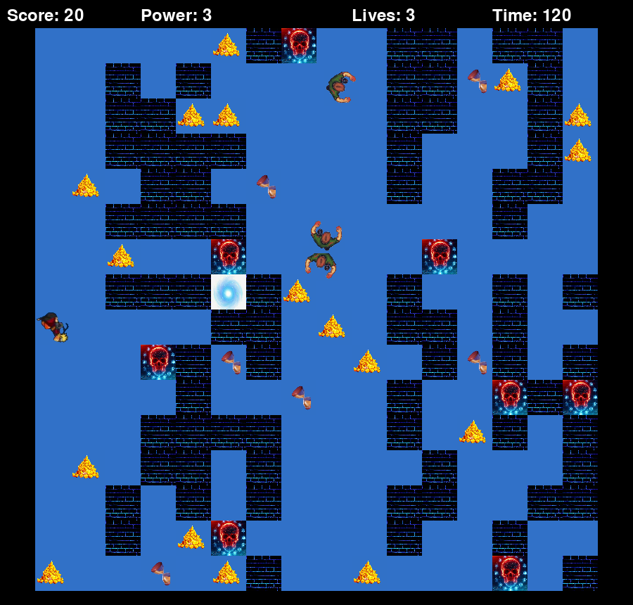

# Finding the One Piece: a maze adventure

A 2D maze game written in Python with [pygame](https://www.pygame.org/).
Every round generates a new random maze. Find the exit before the timer runs
out, collect treasure, avoid enemies and trap walls, and blast enemies with
power waves.



## Features

- **Random mazes**: a new layout every game, always with a path to the exit
- **3 difficulty levels**: more walls, more enemies and less time as you go up
- **Enemies** that wander the maze, and **trap walls** that cost a life
- **Pick-ups**: treasure (+10 points), clocks (+1 second), power orbs (+1 power)
- **Power waves** that destroy enemies
- A scrolling camera that follows the player around a 32×32-tile world
- Results screen with score, kills, lives and time left
- **High-score table** per level, saved between runs
- **Hint key** that shows the shortest way to the exit (found with breadth-first search), at a cost of 5 seconds

## Getting started

Requires Python 3.10+.

```bash
git clone https://github.com/DPaneendranadha/Maze-game.git
cd Maze-game
python3 -m venv .venv
source .venv/bin/activate        # Windows: .venv\Scripts\activate
pip install -r requirements.txt
python main.py                   # or: python -m maze_game
```

## Controls

| Key | Action |
|---|---|
| Arrow keys | Move |
| Space + arrow key | Fire a power wave in that direction |
| H | Show the shortest path to the exit for 3 s (costs 5 s) |
| 1 / 2 / 3 | Pick a level on the level-select screen |
| Esc | Leave the level (in game) / quit (on title screen) |
| Left Shift + Up/Down | Sound-effect volume |
| Tab + Up/Down | Music volume |

## Scoring

| Event | Points |
|---|---|
| Treasure collected | +10 |
| Enemy destroyed | +10 |
| Each 0.1 s left on the clock at the end | +1 |
| Each life left at the end | +100 |

## Project structure

```
Maze-game/
├── main.py              # entry point
├── maze_game/
│   ├── config.py        # window size, speeds, item counts, level difficulty
│   ├── maze.py          # random maze generation + BFS path finding (no pygame)
│   ├── sprites.py       # tiles, animated sprites, enemies, power waves
│   ├── assets.py        # image cache and sound/volume handling
│   ├── highscores.py    # best scores per level, saved as JSON (no pygame)
│   └── game.py          # game loop and the five screens
├── assets/
│   ├── images/          # ui/, tiles/, items/, player/, enemies/, effects/
│   └── sounds/
└── tests/
    ├── test_maze.py     # checks every generated maze is solvable, etc.
    └── test_highscores.py
```

### How the maze is generated

1. Pick random waypoints across the map, ordered left to right.
2. Join them with L-shaped segments. This path from the top-left corner to
   the exit is guaranteed to stay open.
3. Every other cell becomes a wall with a level-dependent probability.
4. Treasure, clocks, power orbs, trap walls and enemies are scattered on top.

Details are in [`maze_game/maze.py`](maze_game/maze.py).

High scores are stored in `~/.local/share/maze-game/highscores.json` on Linux,
`~/Library/Application Support/maze-game/` on macOS and `%APPDATA%\maze-game\` on Windows.

## Running the tests

```bash
pip install -r requirements-dev.txt
pytest
```

## Roadmap

- [ ] Original artwork and music (replacing the current fan-made assets)
- [x] High-score table saved between runs
- [ ] Smarter enemies that chase the player
- [x] "Show hint" using the built-in BFS path finder
- [ ] Proper maze algorithms (recursive backtracker, Prim's) as alternative generators
- [ ] Pause menu and on-screen volume controls
